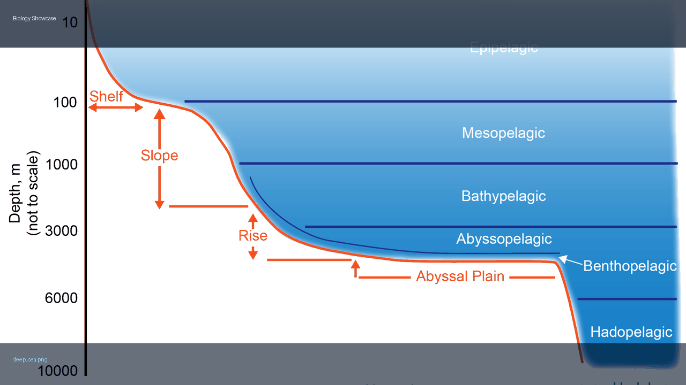
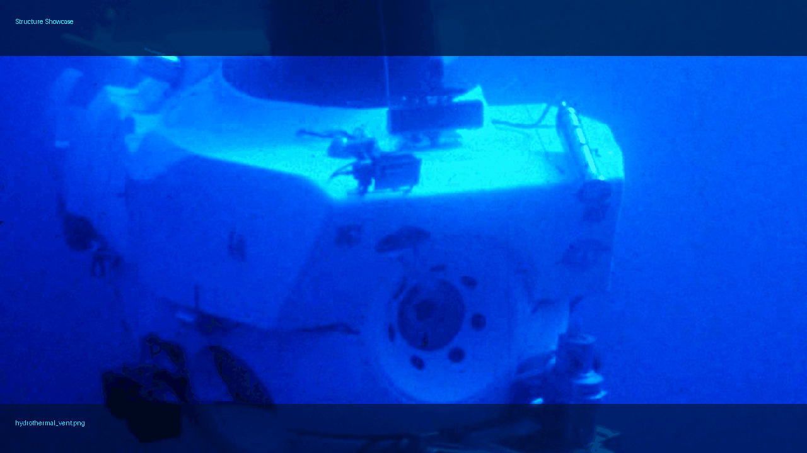
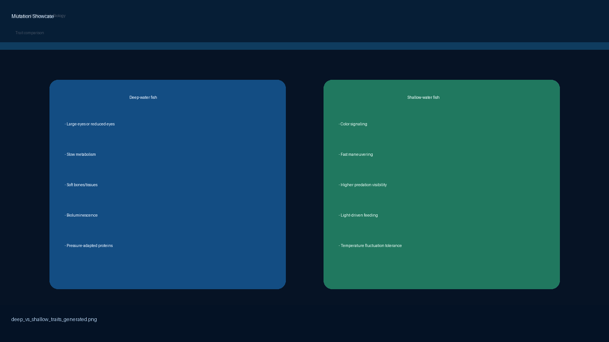
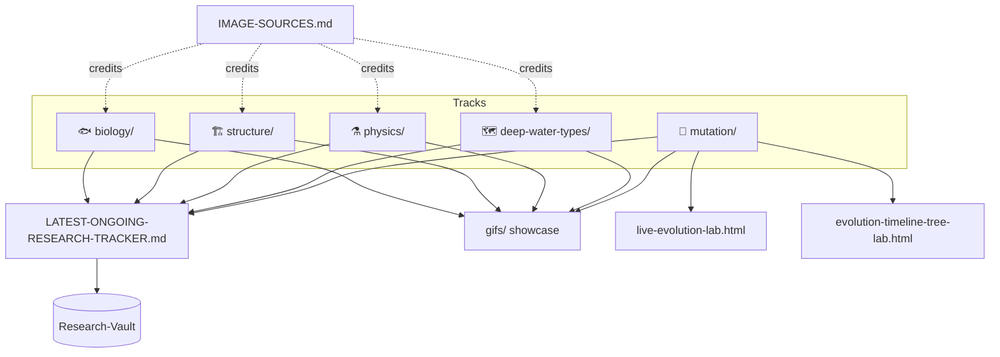

<div align="center">


# 🌊 Under Water Deep Research

### An open research notebook on the deep ocean — biology, physics, structures, habitats and evolution

  

[](LICENSE)    

[](https://codespaces.new/shiroonigami23-ui/under-water-deep-research?quickstart=1) [](https://github.com/shiroonigami23-ui/under-water-deep-research/archive/refs/heads/main.zip)

[**Overview**](#-overview) · [**Features**](#-features) · [**Architecture**](#-architecture) · [**Getting Started**](#-getting-started) · [**Roadmap**](#-roadmap)

</div>

---

## 📸 Preview

<p align="center">
  
  
  
  
</p>

## 📖 Overview

**Under Water Deep Research** is a structured, living research node about the deep ocean. Work is split into five parallel
tracks — **biology, structure, physics & chemistry, deep-water types, and mutation/adaptation** — each with its own notes,
generated figures, image credits and a list of active questions. Two **interactive HTML labs** let you simulate how deep-sea
life evolves under pressure, darkness and cold.

A tracker (`LATEST-ONGOING-RESEARCH-TRACKER.md`) follows current expeditions and discoveries (e.g. NOAA Okeanos/Nautilus
2025 reports, 2026 Coral Sea finds) with dated sources. The repo is linked from my broader [Research-Vault](https://github.com/shiroonigami23-ui/Research-Vault).

### ✨ Highlights

- **5 research tracks** with consistent structure: concepts → open questions → dated studies → evidence
- **2 interactive labs** — live evolution simulator and evolution timeline tree
- **Generated comparison figures** — fish-type matrix, living-condition gradients, basin cross-sections
- **Source discipline** — every image credited in `IMAGE-SOURCES.md`; every claim dated in the tracker

## 🧩 Features

| Feature | What it does |
|---|---|
| **Biology track** | `biology/` — deep-sea animal adaptations, deep vs shallow fish comparison, ongoing biodiversity studies |
| **Structure track** | `structure/` — natural (trenches, vents, seamounts) and artificial (wrecks, cables, rigs) structures |
| **Physics & chemistry** | `physics/` — pressure, light attenuation, temperature, circulation, chemistry |
| **Deep-water types** | `deep-water-types/` — fjords, brine pools, volcanic margins, land–water–land basins |
| **Mutation & adaptation** | `mutation/` — evolutionary pathways under extreme conditions |
| **Live Evolution Lab** | `mutation/live-evolution-lab.html` — interactive simulation in the browser |
| **Evolution Timeline Tree** | `mutation/evolution-timeline-tree-lab.html` — explore branching adaptations over time |
| **Research tracker** | `LATEST-ONGOING-RESEARCH-TRACKER.md` — dated, sourced feed of new findings |

## 🛠 Tech Stack

| Layer | Technology |
|---|---|
| Writing | Markdown |
| Interactive labs | HTML5, CSS, vanilla JavaScript |
| Figures | Generated PNG matrices/diagrams + curated photos (credited) |
| Showcase | Animated GIF montages per track |

## 🏗 Architecture

Five independent tracks feed a shared tracker and showcase; each track follows the same template.



➡️ Full design notes, data flow and design decisions: **[docs/ARCHITECTURE.md](docs/ARCHITECTURE.md)**

## 📁 Project Structure

```text
under-water-deep-research/
├── biology/            # deep-sea-animal-biology.md, fish-type-comparative-research.md, ongoing-studies-2025-2026.md, png/
├── structure/          # natural-structures.md, artificial-structures.md, png/
├── physics/            # deep-ocean-physics-chemistry.md, png/
├── deep-water-types/   # deep-water-types-and-geographies.md, png/
├── mutation/           # live-evolution-lab.html, evolution-timeline-tree-lab.html, png/
├── gifs/               # per-track showcase GIFs
├── connected/          # link to Research-Vault
├── IMAGE-SOURCES.md
└── LATEST-ONGOING-RESEARCH-TRACKER.md
```

## 🚀 Getting Started

### Prerequisites

- A browser (for the labs) and any Markdown viewer

### 1. Get the code

Pick whichever method suits you:

| Method | Command |
|---|---|
| **HTTPS** | `git clone https://github.com/shiroonigami23-ui/under-water-deep-research.git` |
| **SSH** | `git clone git@github.com:shiroonigami23-ui/under-water-deep-research.git` |
| **GitHub CLI** | `gh repo clone shiroonigami23-ui/under-water-deep-research` |
| **ZIP** | [Download](https://github.com/shiroonigami23-ui/under-water-deep-research/archive/refs/heads/main.zip) and extract |
| **Codespaces** | [Open in browser](https://codespaces.new/shiroonigami23-ui/under-water-deep-research?quickstart=1) — zero local setup, dev container preconfigured |

> 🔑 **Using SSH for the first time?** Generate a key with `ssh-keygen -t ed25519 -C "you@example.com"`, add the `.pub` contents at **GitHub → Settings → SSH and GPG keys**, then test with `ssh -T git@github.com`.

### 2. Install & set up

```bash
cd under-water-deep-research
python3 -m http.server 8080      # optional: serve the labs locally
```

### 3. Run

- Read the tracks directly on GitHub, starting from each folder's `README.md`.
- Open <http://localhost:8080/mutation/live-evolution-lab.html> and `evolution-timeline-tree-lab.html` for the interactive labs.

## 🎮 Usage

**Working rule for every track**

1. Core concepts
2. Active research questions
3. Latest ongoing studies **with dates**
4. Linked evidence and visual assets (credited in `IMAGE-SOURCES.md`)

To contribute a finding, add it to the relevant track *and* to the tracker with its source URL and date.

## 🗺 Roadmap

**Phase 1 — Foundation (done, Apr 2026)**

- [x] Five research tracks with READMEs and figures
- [x] Two interactive evolution labs
- [x] GIF showcase and image-source register
- [x] Dated research tracker

**Phase 2 — Depth**

- [ ] Add a references section (DOI-linked) to every track document
- [ ] Hadal-zone (>6,000 m) sub-track and trench case studies
- [ ] Data plots from open datasets (NOAA, OBIS, GEBCO bathymetry)

**Phase 3 — Interactivity**

- [ ] Interactive depth-profile explorer (pressure, light, temperature vs depth)
- [ ] Species map using OBIS occurrence data
- [ ] Publish the whole repo as a GitHub Pages microsite with navigation

**Phase 4 — Output**

- [ ] Compile a review-style paper / long-form article from the tracks
- [ ] Quarterly tracker digests

➡️ Detailed plan, milestones and long-term vision: **[docs/ROADMAP.md](docs/ROADMAP.md)**

## 🤝 Contributing

Contributions, issues and feature requests are welcome!

1. Fork the repository
2. Create a feature branch: `git checkout -b feature/amazing-feature`
3. Commit your changes: `git commit -m "feat: add amazing feature"`
4. Push the branch: `git push origin feature/amazing-feature`
5. Open a Pull Request against `main`

Check the [issues page](https://github.com/shiroonigami23-ui/under-water-deep-research/issues) and the [roadmap](docs/ROADMAP.md) for ideas on where to help.

## 📜 Changelog

See [CHANGELOG.md](CHANGELOG.md) for the release history.

## 📄 License

Distributed under the **MIT** license. See [LICENSE](LICENSE) for details.

## 👤 Author

**Aryan Singh Chandel** (Shiro)

[](https://github.com/shiroonigami23-ui)

<div align="center">

⭐ **If you find this project useful, consider giving it a star!** ⭐

</div>
