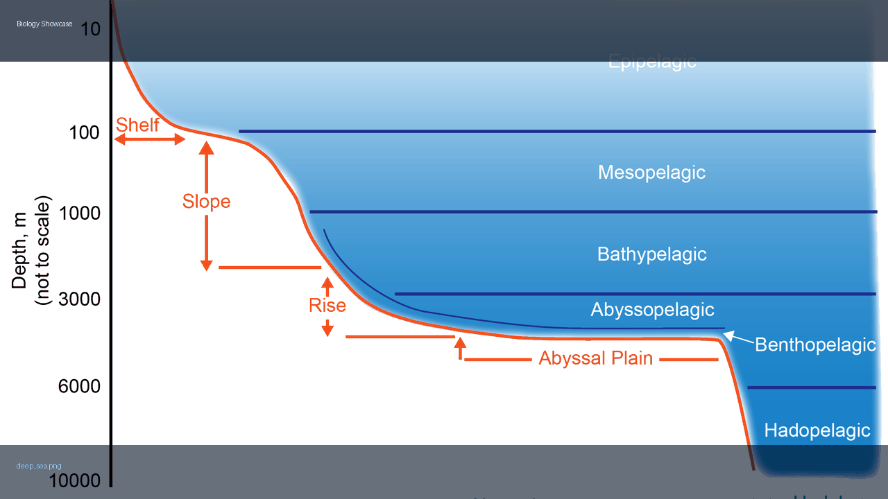
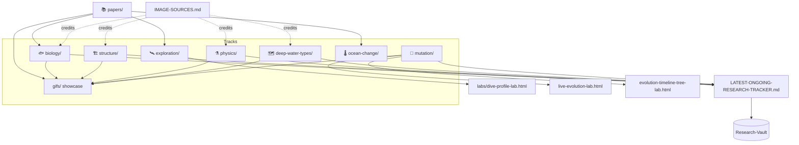

<div align="center">



# 🌊 Under Water Deep Research

### A sourced, visual research hub on the deep ocean: biology, exploration, seabed governance, ocean change, physics, habitats and evolution

   

[](LICENSE)     [](https://github.com/shiroonigami23-ui/under-water-deep-research/actions/workflows/validate.yml) [](https://shiroonigami23-ui.github.io/under-water-deep-research/) 

[](https://codespaces.new/shiroonigami23-ui/under-water-deep-research?quickstart=1) [](https://github.com/shiroonigami23-ui/under-water-deep-research/archive/refs/heads/main.zip)

[**🌐 Hub site**](https://shiroonigami23-ui.github.io/under-water-deep-research/) · [**Overview**](#-overview) · [**What's new**](#-whats-new-nov-2026) · [**Features**](#-features) · [**Architecture**](#-architecture) · [**Getting Started**](#-getting-started) · [**Roadmap**](#-roadmap)

</div>

---

## 📸 Preview

<p align="center">
  
  
  
  
</p>

## 📖 Overview

**Under Water Deep Research** is a living research hub on the deep ocean. It now has **eight tracks**:

- biology
- **exploration**
- **governance & mining**
- **ocean change**
- physics & chemistry
- structure
- deep-water types
- mutation/adaptation

Each track follows the same template: concepts → open questions → dated studies → sources, with original figures.

A **paper-analysis library** (`papers/`) gives structured deep reads of the key studies. **Three interactive labs** run in the browser. A dated **tracker** follows the ISA, NOAA permits, the High Seas Treaty, new species, mapping, bleaching and AMOC.

🌐 **Browse the encyclopedia:** <https://shiroonigami23-ui.github.io/under-water-deep-research/>

### 🗂 The website (v3)

The repository now builds a full multi-page **deep-ocean encyclopedia** site:

| Part | What's in it |
|---|---|
| 🐠 **Species Atlas** | 72 profiles (deep-sea fish, sharks, cephalopods, crustaceans, corals, vent fauna, mammals, turtles, seabirds, reef fish, plants and algae, microbes). Each covers habitat and type of water, depth range, feeding and hunting, mating, migration, behaviour, adaptations and conservation, with a depth chart and filterable catalog |
| 🌊 **Seas & Oceans** | All 5 oceans and 21 major seas: area, depths, deepest point, salinity, currents, life, people, threats |
| 📖 **39 articles** in 8 sections | Ocean system, deep-sea life, seafloor and habitats, exploration, ocean and climate, impacts and governance, library, data. Every claim is footnoted, with a combined [sources page](https://shiroonigami23-ui.github.io/under-water-deep-research/wiki/sources.html) |
| 📡 **Live tracker on every page** | Collapsible bar with 10 research and policy streams, each linking to an expandable detail section |
| 📄 **Paper library as PDFs** | Each paper analysis opens as a PDF in a new tab or downloads (`assets/pdf/`) |
| 📷 **Real photos** | Species and seas load openly licensed photos from Wikimedia Commons, credited and linked to their file pages. The [Photo status](https://shiroonigami23-ui.github.io/under-water-deep-research/wiki/photo-status.html) page lists any entry still without one, with a Nano Banana prompt (also in [`prompts.md`](prompts.md)) |

Build it locally: `pip install -r scripts/requirements.txt && python scripts/build_site.py`. Content lives in `site_src/` (Markdown articles plus `data/*.json` catalogs).

### ✨ Highlights

- **8 research tracks**, including three new ones (exploration, governance & mining, ocean change)
- **5 paper deep-reads** (Nature, Nature Geoscience, Science Advances), plus a reading list of papers to open yourself
- **Dive Profile Lab**: pressure, light, temperature, a Boyle's-law balloon and life zones from 0 to 10,935 m
- **Tracker refreshed to 15 Nov 2026**, with a status board and monthly digest
- **Reproducible figures** (`scripts/generate_figures.py`) and CI link checks

## 🆕 What's New (Nov 2026)

| Finding | Number | Where |
|---|---|---|
| Deep seafloor ever seen by camera | **≤0.001%** | [exploration](exploration/) · [Bell 2025](papers/bell-2025-how-little-weve-seen.md) |
| Seafloor mapped (Seabed 2030) | **28.7%** | [exploration](exploration/) |
| Deepest chemosynthetic animal community | **9,533 m** | [Peng 2025](papers/peng-2025-hadal-chemosynthesis.md) |
| New marine species in one year | **1,121** | [biology](biology/ongoing-studies-2025-2026.md) |
| Reef area hit by 4th bleaching event | **84.4%** | [ocean-change](ocean-change/) |
| Projected AMOC weakening by 2100 | **43–59%** | [Portmann 2026](papers/portmann-2026-amoc-weakening.md) |
| ISA Mining Code | **still not adopted** | [governance](governance-and-mining/) |

<div align="center">

<br> 
</div>

## 🧩 Features

| Feature | What it does |
|---|---|
| **Biology track** | `biology/` — deep-sea animal adaptations, deep vs shallow fish comparison, ongoing biodiversity studies |
| **Structure track** | `structure/` — natural (trenches, vents, seamounts) and artificial (wrecks, cables, rigs) structures |
| **Physics & chemistry** | `physics/` — pressure, light attenuation, temperature, circulation, chemistry |
| **Deep-water types** | `deep-water-types/` — fjords, brine pools, volcanic margins, land–water–land basins |
| **Mutation & adaptation** | `mutation/` — evolutionary pathways under extreme conditions |
| **Live Evolution Lab** | `mutation/live-evolution-lab.html` — interactive simulation in the browser |
| **Evolution Timeline Tree** | `mutation/evolution-timeline-tree-lab.html` — explore branching adaptations over time |
| **Research tracker** | `LATEST-ONGOING-RESEARCH-TRACKER.md`: dated status board + monthly digest |
| **Exploration track** | `exploration/`: mapping vs imaging, depth records, platforms |
| **Governance & mining** | `governance-and-mining/`: ISA, NOAA/TMC, BBNJ, evidence base, both sides' arguments |
| **Ocean change** | `ocean-change/`: coral bleaching, AMOC, pressure & light profiles |
| **Paper library** | `papers/`: structured deep reads + reading list |
| **Dive Profile Lab** | `labs/dive-profile-lab.html`: interactive depth explorer |
| **Hub website** | `index.html` served on GitHub Pages |
| **Glossary** | `GLOSSARY.md`: 20+ deep-ocean terms |

## 🛠 Tech Stack

| Layer | Technology |
|---|---|
| Writing | Markdown |
| Interactive labs | HTML5, CSS, vanilla JavaScript |
| Figures | Generated PNGs (`scripts/generate_figures.py`, Matplotlib) + curated photos (credited) |
| Automation | GitHub Actions (`validate.yml`), GitHub Pages hub |
| Showcase | Animated GIF montages per track |

## 🏗 Architecture

Five independent tracks feed a shared tracker and showcase; each track follows the same template.



➡️ Full design notes, data flow and design decisions: **[docs/ARCHITECTURE.md](docs/ARCHITECTURE.md)**

## 📁 Project Structure

```text
under-water-deep-research/
├── biology/            # deep-sea-animal-biology.md, fish-type-comparative-research.md, ongoing-studies-2025-2026.md, png/
├── structure/          # natural-structures.md, artificial-structures.md, png/
├── physics/            # deep-ocean-physics-chemistry.md, png/
├── deep-water-types/   # deep-water-types-and-geographies.md, png/
├── mutation/           # live-evolution-lab.html, evolution-timeline-tree-lab.html, png/
├── exploration/        # exploration-methods-and-records.md, png/
├── governance-and-mining/  # seabed-governance-2026.md, png/
├── ocean-change/       # ocean-change-2026.md, png/
├── papers/             # structured paper deep-reads + reading list
├── labs/               # dive-profile-lab.html
├── scripts/            # generate_figures.py, check_links.py
├── index.html          # GitHub Pages hub homepage
├── GLOSSARY.md
├── gifs/               # per-track showcase GIFs
├── connected/          # link to Research-Vault
├── IMAGE-SOURCES.md
└── LATEST-ONGOING-RESEARCH-TRACKER.md
```

## 🚀 Getting Started

### Prerequisites

- A browser (for the labs) and any Markdown viewer

### 1. Get the code

Pick whichever method suits you:

| Method | Command |
|---|---|
| **HTTPS** | `git clone https://github.com/shiroonigami23-ui/under-water-deep-research.git` |
| **SSH** | `git clone git@github.com:shiroonigami23-ui/under-water-deep-research.git` |
| **GitHub CLI** | `gh repo clone shiroonigami23-ui/under-water-deep-research` |
| **ZIP** | [Download](https://github.com/shiroonigami23-ui/under-water-deep-research/archive/refs/heads/main.zip) and extract |
| **Codespaces** | [Open in browser](https://codespaces.new/shiroonigami23-ui/under-water-deep-research?quickstart=1) — zero local setup, dev container preconfigured |

> 🔑 **Using SSH for the first time?** Generate a key with `ssh-keygen -t ed25519 -C "you@example.com"`, add the `.pub` contents at **GitHub → Settings → SSH and GPG keys**, then test with `ssh -T git@github.com`.

### 2. Install & set up

```bash
cd under-water-deep-research
python3 -m http.server 8080      # optional: serve the labs locally
```

### 3. Run

- Read the tracks directly on GitHub, starting from each folder's `README.md`.
- Open <http://localhost:8080/> for the hub homepage, or `labs/dive-profile-lab.html`, `mutation/live-evolution-lab.html` and `evolution-timeline-tree-lab.html` for the labs.
- Rebuild figures: `pip install -r scripts/requirements.txt && python scripts/generate_figures.py`

## 🎮 Usage

**Working rule for every track**

1. Core concepts
2. Active research questions
3. Latest ongoing studies **with dates**
4. Linked evidence and visual assets (credited in `IMAGE-SOURCES.md`)

To contribute a finding, add it to the relevant track *and* to the tracker with its source URL and date.

## 🗺 Roadmap

**Phase 1 — Foundation (done, Apr 2026)**

- [x] Five research tracks with READMEs and figures
- [x] Two interactive evolution labs
- [x] GIF showcase and image-source register
- [x] Dated research tracker

**Phase 2 — Depth (mostly done, Nov 2026)**

- [x] DOI-linked paper deep-reads (`papers/`) + reading list
- [x] Hadal-zone records and trench case study (9,533 m chemosynthesis, snailfish limit)
- [x] Three new tracks: exploration, governance & mining, ocean change
- [ ] Data plots from open datasets (OBIS occurrences, GEBCO grid extracts)

**Phase 3 — Interactivity**

- [x] Interactive depth-profile explorer (`labs/dive-profile-lab.html`)
- [x] GitHub Pages hub homepage with navigation (`index.html`)
- [ ] Species map using OBIS occurrence data

**Phase 4 — Output**

- [ ] Compile a review-style paper / long-form article from the tracks
- [ ] Quarterly tracker digests

➡️ Detailed plan, milestones and long-term vision: **[docs/ROADMAP.md](docs/ROADMAP.md)**

## 🤝 Contributing

Contributions, issues and feature requests are welcome!

1. Fork the repository
2. Create a feature branch: `git checkout -b feature/amazing-feature`
3. Commit your changes: `git commit -m "feat: add amazing feature"`
4. Push the branch: `git push origin feature/amazing-feature`
5. Open a Pull Request against `main`

Check the [issues page](https://github.com/shiroonigami23-ui/under-water-deep-research/issues) and the [roadmap](docs/ROADMAP.md) for ideas on where to help.

## 📜 Changelog

See [CHANGELOG.md](CHANGELOG.md) for the release history.

## 📄 License

Distributed under the **MIT** license. See [LICENSE](LICENSE) for details.

## 👤 Author

**Aryan Singh Chandel** (Shiro)

[](https://github.com/shiroonigami23-ui)

<div align="center">

⭐ **If you find this project useful, consider giving it a star!** ⭐

</div>
