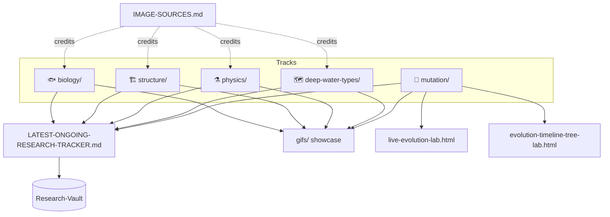

# 🏗 Architecture — Under Water Deep Research

> Part of [under-water-deep-research](https://github.com/shiroonigami23-ui/under-water-deep-research). Back to the [README](../README.md).

## 1. System Overview

The repository is a content system rather than a codebase. Each track is a folder with the same template (README,
topic documents, `png/` assets). Cross-cutting files — the tracker, image-source register and GIF showcase — aggregate
across tracks. The two HTML labs are self-contained pages with inline JavaScript.

## 2. Components

| Component | Location | Responsibility |
|---|---|---|
| **Biology** | `biology/` | Adaptations, comparative fish research, ongoing studies |
| **Structure** | `structure/` | Natural and artificial deep-water structures |
| **Physics** | `physics/` | Physical and chemical ocean properties |
| **Deep-water types** | `deep-water-types/` | Geographic classification of deep waters |
| **Mutation** | `mutation/` | Adaptation pathways + interactive labs |
| **Tracker** | `LATEST-ONGOING-RESEARCH-TRACKER.md` | Dated feed of new discoveries with sources |
| **Credits** | `IMAGE-SOURCES.md` | Provenance and licences for images |

## 3. Data / Control Flow

1. A new source (paper, expedition report) is read and summarised into the relevant track.
2. Key facts get a dated entry in the tracker with the source link.
3. Figures are generated or curated into the track's `png/` folder and credited.
4. Showcase GIFs are regenerated to include new visuals.

## 4. Key Design Decisions

| Decision | Rationale |
|---|---|
| Track-per-folder | Lets work proceed in parallel and keeps each topic self-contained |
| Dates on every claim | Ocean research moves fast; dated entries make staleness obvious |
| Self-contained HTML labs | No build step — open the file and it runs |

## 5. Known Limitations

- Formal citations (DOIs) are not yet attached to every statement
- Labs are illustrative simulations, not scientific models

---
## Hub additions (2026-11-15)

| Component | Location | Responsibility |
|---|---|---|
| New tracks | `exploration/`, `governance-and-mining/`, `ocean-change/` | Same template as the original five |
| Paper library | `papers/` | One file per paper, fixed template, states its analysis basis |
| Labs | `labs/dive-profile-lab.html` | Single-file depth explorer |
| Figure pipeline | `scripts/generate_figures.py` | Rebuilds hub figures from cited values |
| CI | `.github/workflows/validate.yml` | Figure smoke test + link check |
| Hub homepage | `index.html` + `.nojekyll` | GitHub Pages landing page linking tracks, labs, tracker, papers |

*Last updated: 2026-11-15*
