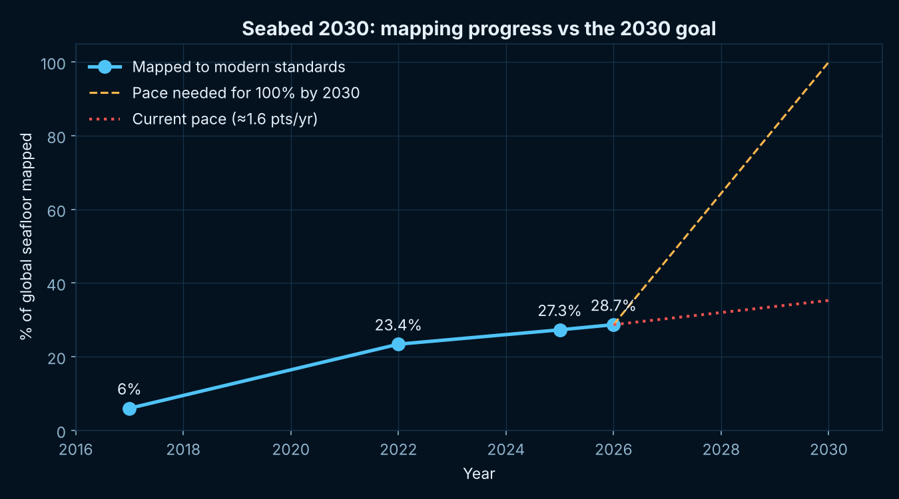
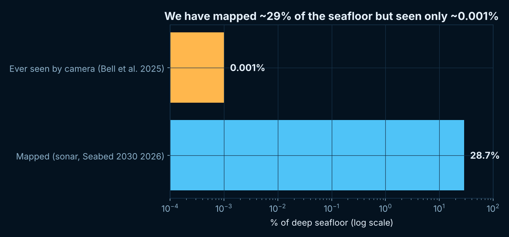
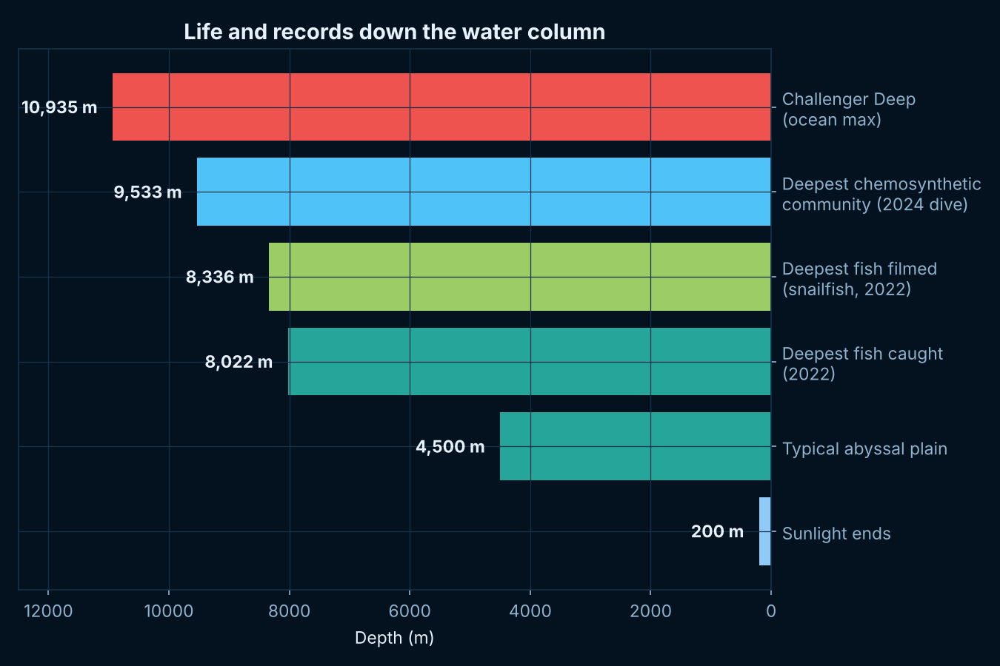

# 🛰 Exploration — how we see the deep

Mapping, imaging and sampling the 66% of Earth that is deep ocean, and how little of it we have actually looked at.

## Pattern Summary

- **Mapping is accelerating but behind schedule.** Seabed 2030 reached **28.7%** of the seafloor in April 2026, up from 6% in 2017. At the current pace it will not reach 100% by 2030.
- **Seeing is far rarer than mapping.** Only about **0.001%** of the deep seafloor has ever been imaged, and 97% of dives come from just five countries.
- **Crewed hadal submersibles are rewriting the depth limits of life.** Fendouzhe found flourishing chemosynthetic animals at **9,533 m**, and baited cameras filmed a snailfish at **8,336 m**.

## Gallery

## Notes

- [`exploration-methods-and-records.md`](./exploration-methods-and-records.md): methods, records, bias, sources
- Lab: [`../labs/dive-profile-lab.html`](../labs/dive-profile-lab.html), an interactive depth explorer
