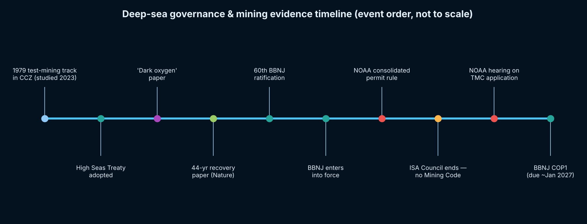
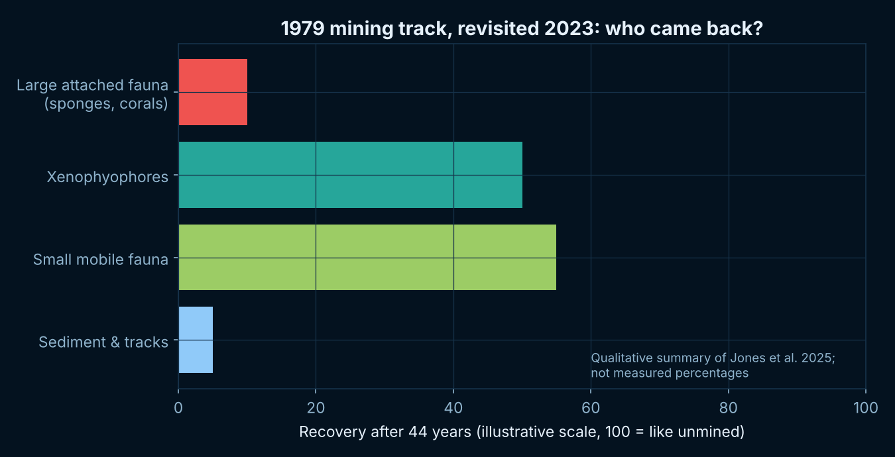

# ⚖️ Governance and Mining — who decides what happens to the deep seabed

The International Seabed Authority (ISA), the new High Seas Treaty, a parallel US permit route, and the science each side cites.

## Pattern Summary

- **ISA:** still no Mining Code after Part II of the 31st session (July 2026). No exploitation has been approved.
- **United States:** NOAA's January 2026 rule created a fast consolidated permit route. TMC USA's ~65,000 km² Clarion-Clipperton Zone application was found fully compliant, and a public hearing was held on 13 Oct 2026.
- **High Seas Treaty (BBNJ):** in force since 17 Jan 2026. COP1 is due by about January 2027.
- **Evidence:** a 1979 mining track still shows clear damage after 44 years. The "dark oxygen" claim is contested and now has a dedicated follow-up programme.

## Gallery

## Notes

- [`seabed-governance-2026.md`](./seabed-governance-2026.md): ISA, NOAA/TMC, BBNJ, evidence base and both sides' arguments
