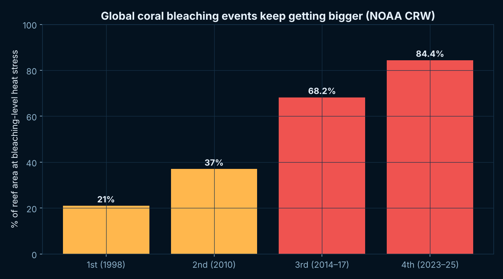
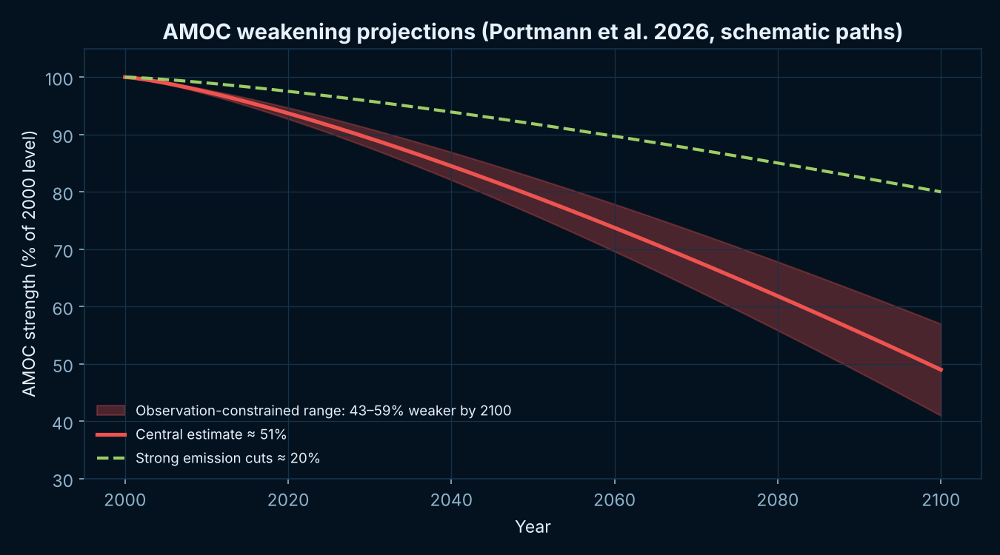
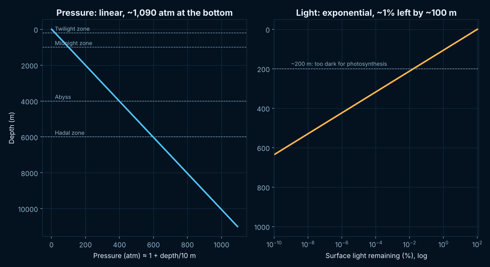

# 🌡 Ocean Change — heat, circulation and reefs

How a warming ocean reaches the deep: through circulation (AMOC), heat uptake and ecosystem stress such as bleaching.

## Pattern Summary

- The **4th global coral bleaching event** (2023–2025) exposed **84.4%** of reef area to bleaching-level heat stress, up from 21% in 1998. NOAA says reefs are entering an era of near-annual bleaching.
- **AMOC** is weakening in observations. A 2026 observation-constrained study projects **~43–59% weakening by 2100**, which means the "pessimistic" models look the most realistic.
- The deep ocean absorbs roughly 90% of excess heat and about 30% of human CO₂, so changes up top end up in the deep.

## Gallery

## Notes

- [`ocean-change-2026.md`](./ocean-change-2026.md): bleaching, AMOC and deep-ocean heat, with sources
