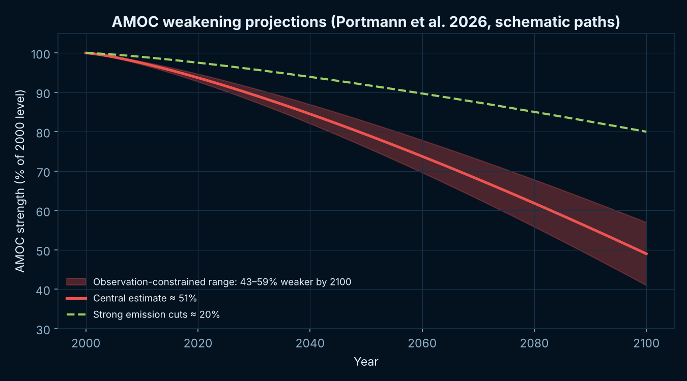

The **Atlantic Meridional Overturning Circulation (AMOC)** carries warm surface water north. There it cools, sinks and flows back south at depth, delivering oxygen and carbon to the deep Atlantic (see [Deep circulation](/wiki/ocean-system/deep-circulation.html)).

{{chart:amoc}}

## What the 2026 evidence says

- **Observed:** weakening at four latitudes over two decades (University of Miami study, April 2026).
- **Projected (Portmann et al. 2026, *Science Advances*):** combining models with temperature and salinity observations gives **43–59% weakening by 2100** (central ≈51%). That is about 60% stronger than the multi-model average. Aggressive emission cuts reduce it to about 20%. Greenland meltwater is not included, so this may be an underestimate[^ls][^sf].
- **Committed collapse?** A July 2026 ensemble study argues there is a significant probability that collapse is already locked in[^at].

:::debate Where scientists disagree
The IPCC AR6 assessed collapse before 2100 as **"very unlikely"** (medium confidence). Newer observation-constrained studies argue the risk is higher. Disagreements centre on model biases in salinity, how to read short observational records, and early-warning statistics from proxy data.
:::

## Consequences of a major slowdown

- Colder winters in northwest Europe, despite global warming.
- Faster sea-level rise along the US East Coast.
- Shifted tropical rain belts, affecting monsoons in West Africa and South Asia.
- **Less oxygen and carbon reaching the deep North Atlantic**, affecting cold-water coral reefs and deep fauna.
- Reduced ocean uptake of CO₂.

Full analysis of the paper: [Portmann et al. 2026](/wiki/library/portmann-2026.html).

[^ls]: Live Science on Portmann et al. 2026, doi:10.1126/sciadv.adx4298 — <https://www.livescience.com/planet-earth/climate-change/nations-need-to-prepare-now-key-atlantic-ocean-current-is-much-closer-to-collapse-than-scientists-thought>
[^sf]: Science Focus, emission-scenario detail — <https://www.sciencefocus.com/news/amoc-weakening-faster-than-we-thought>
[^at]: Arctic Today, "AMOC collapse may already be locked in" (Jul 2026) — <https://www.arctictoday.com/amoc-collapse-may-already-be-locked-in-new-study-suggests/>
