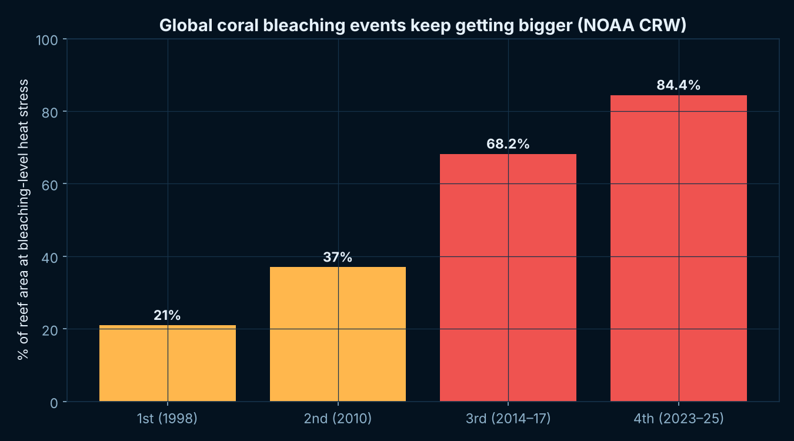

Corals live in partnership with symbiotic algae (zooxanthellae) that supply most of their food and colour. When water is too warm for too long, corals expel the algae and turn white. If the heat lasts, they starve and die.

## Global bleaching events

| Event | Years | Reef area at bleaching-level heat stress |
|---|---|---|
| 1st | 1998 | 21% |
| 2nd | 2010 | 37% |
| 3rd | 2014–2017 | 68.2% |
| **4th** | **2023–2025** | **84.4%**, with mass bleaching in ≥83 countries and territories |

NOAA confirmed the fourth event on 15 April 2024. It likely ended after severe bleaching in Western Australia in early 2025. NOAA confirmed the end only after no widespread bleaching occurred in the Dec 2025–Feb 2026 austral summer (update of 2 June 2026)[^crw][^gcrmn].

## An era of near-annual bleaching

Every strong El Niño since 1998 has coincided with a global event, and reefs now get too little time to recover between heatwaves. A building El Niño raised concern again in mid-2026.

## Are deep reefs a refuge?

**Mesophotic reefs** (30–150 m) were once hoped to be refuges. They help in some places, but heat can reach them through mixing and internal waves. **Cold-water corals** in the deep sea face a different combination: acidification, deoxygenation and trawling (see [Acidification](/wiki/climate/acidification.html)).

## What helps

- Rapid emission cuts. This is the only long-term fix.
- Reducing local stressors: pollution, overfishing and sedimentation.
- Assisted evolution, heat-tolerant coral breeding and restoration. These are promising but small-scale.

[^crw]: NOAA Coral Reef Watch, global bleaching status page — <https://coralreefwatch.noaa.gov/satellite/research/coral_bleaching_report.php>
[^gcrmn]: GCRMN, "The 4th global bleaching event has likely ended" — <https://gcrmn.net/2026/06/08/4gbe-ended/>
