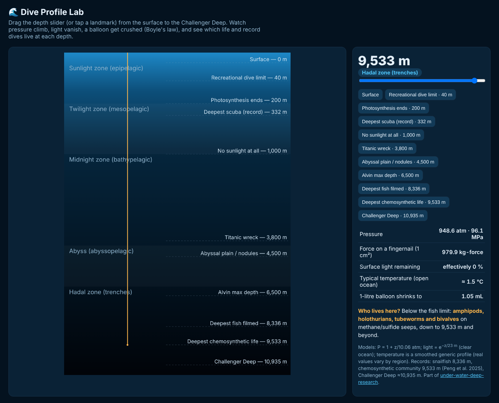

## Dive Profile Lab

Drag the submersible from the surface to the bottom of the Challenger Deep. The lab shows **pressure** (atmospheres and kg per cm²), **remaining sunlight**, typical **temperature**, the ocean **zone**, and which animals and vehicles live or operate at that depth.

<a class="btn" href="/labs/dive-profile-lab.html" target="_blank" rel="noopener">▶ Open the Dive Profile Lab in a new tab</a>

<iframe src="/labs/dive-profile-lab.html" title="Dive Profile Lab" style="width:100%;height:640px;border:1px solid var(--line);border-radius:12px;background:#000" loading="lazy"></iframe>

## The physics behind it

- **Pressure:** about 1 atm plus 1 atm for every 10 m. That is roughly 1,090 atm at the Challenger Deep. See [Pressure, light and temperature](/wiki/ocean-system/pressure-light-temperature.html).
- **Light:** decays roughly exponentially. In clear ocean about 1% remains near 100 m, and effectively none below 1,000 m.
- **Temperature:** a warm mixed layer, then the thermocline, then 0–4 °C almost everywhere below ~1,000 m.
