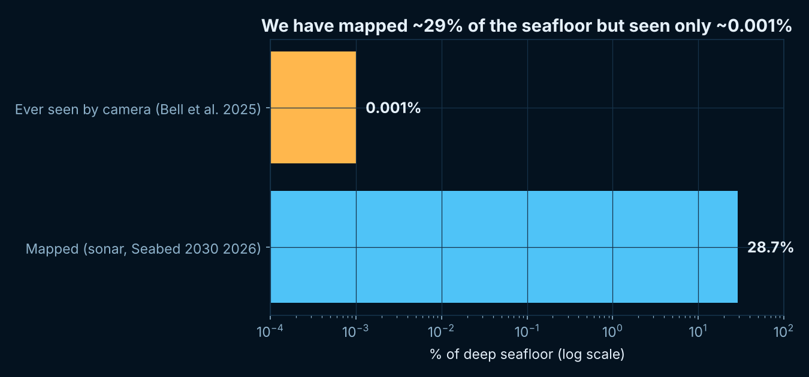

:::facts The numbers (Bell et al. 2025, Science Advances)
- Total deep seafloor ever imaged: about **2,130–3,823 km²**, which is **≤0.001%** of ~336 million km²[^mb].
- Built from ~**44,000** dives since 1958[^time].
- **65%** of observations lie within 200 nautical miles of the **USA, Japan and New Zealand**. **97%** of dives come from five countries[^mi].
- Even if the estimate is off by 10×, less than 0.01% would have any visual record[^eu].
:::

{{chart:seen}}

## Biases

- **Geographic:** waters off a handful of wealthy nations dominate.
- **Habitat:** canyons and ridges are over-sampled. Abyssal plains and seamounts are under-sampled. Monterey Canyon alone accounts for ~48% of canyon observations[^gz].
- **Depth:** most of the ocean lies at 2,000–6,000 m, but dives cluster shallower.

## What it means

1. "Typical deep-sea fauna" is generalised from a sample the size of a small city.
2. **Mining impact assessments** rest on thin baselines.
3. Low-cost exploration tools and partnerships with under-represented nations are essential.

Read the full paper analysis: [Bell et al. 2025](/wiki/library/bell-2025.html).

[^mb]: Mongabay, coverage of Bell et al. 2025 — <https://news.mongabay.com/2025/05/only-a-tiny-of-the-deep-seafloor-has-ever-been-visually-observed-study/>
[^time]: TIME, deep-sea coverage study — <https://partners.time.com/7283470/majority-deep-sea-remains-a-mystery-study>
[^mi]: Marineinfo abstract record — <https://marineinfo.org/doc/publication/408357>
[^eu]: EurekAlert release — <https://www.eurekalert.org/news-releases/1082535>
[^gz]: Gigazine summary — <https://wbgsv0a.gigazine.net/gsc_news/en/20250518-deep-seafloor-study-reveals>
