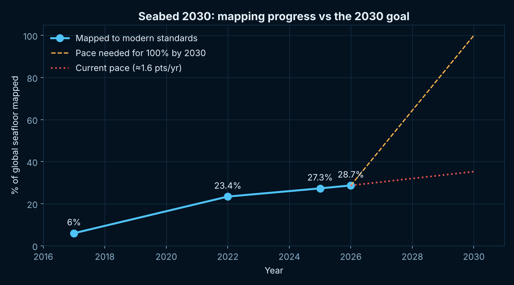

{{chart:seabed}}

## Methods

- **Satellite altimetry:** sea-surface height bulges over seamounts and dips over trenches. This gives a global map, but only at ~kilometre resolution.
- **Multibeam echo sounding:** ships emit a fan of sound beams and time the echoes, mapping a swath several times the water depth wide at ~100 m resolution or better in the deep sea.
- **AUV mapping:** flying close to the seabed for metre-scale resolution.
- **Crowd-sourced bathymetry:** fishing boats, yachts and commercial ships contribute depth data.

## Seabed 2030 progress

:::data Numbers
- **6%** mapped to modern standards at launch in 2017[^nf].
- **27.3%** by June 2025[^nf].
- **28.7%** by April 2026, with almost five million km² added in a year, about 104 million km² in total[^iho].
:::

## Will it finish by 2030?

At ~1.5 percentage points per year, no. Reaching 100% would need roughly an order-of-magnitude acceleration. Uncrewed surface vessels, data-sharing from industry and militaries, and crowd-sourcing are the main levers. Even complete mapping at ~100 m resolution would not show what *lives* there; imaging coverage is far smaller (see [How little we have seen](/wiki/exploration/how-little-we-have-seen.html)).

## Why maps matter

Tsunami modelling, cable routing, navigation, fisheries habitat models, climate models (bottom topography steers currents) and deciding where to protect.

[^nf]: Nippon Foundation, 27.3% mapped and 6% at launch — <https://tnfsa.nippon-foundation.or.jp/news/2756701>
[^iho]: IHO, 28.7% milestone (April 2026) — <https://iho.int/en/global-seabed-mapping-reaches-new-milestone-as-five-million-square-kilometres-added-in-a-year>
