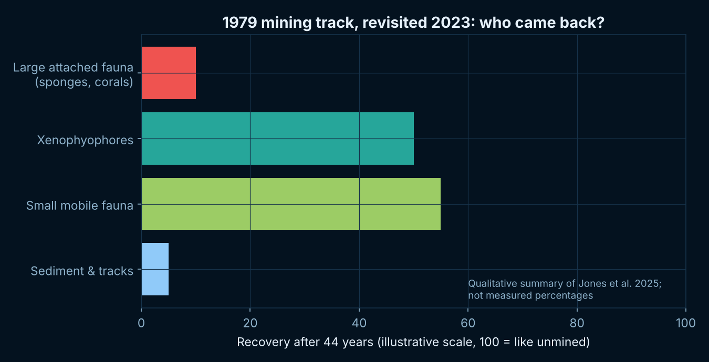

:::facts Three kinds of deep-sea mineral deposit
- **Polymetallic nodules** on abyssal plains (nickel, cobalt, copper, manganese): see [Polymetallic nodules](/wiki/seafloor/polymetallic-nodules.html).
- **Cobalt-rich ferromanganese crusts** on seamount flanks: see [Seamounts](/wiki/seafloor/seamounts-and-abyssal-plains.html).
- **Seafloor massive sulfides** at vents (copper, zinc, gold, silver): see [Hydrothermal vents](/wiki/seafloor/hydrothermal-vents.html).
:::

## How nodule collection would work

A tracked collector vehicle crawls the seafloor, sucking up the top layer of sediment and nodules. A riser pipe lifts the slurry to a ship, and the sediment-laden water is discharged back into the ocean. The main impacts are **habitat removal** (nodules and the animals attached to them), **sediment plumes** near the bottom and at the discharge depth, **noise and light**, and compaction of the seabed.

The policy detail below is kept current in the hub's governance notes.
