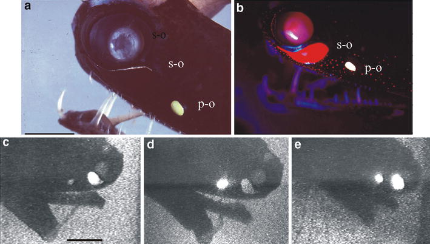

Below 1,000 m, the only light comes from living things. Bioluminescence has evolved independently many dozens of times, so it is a striking example of **convergent evolution**.

## The chemistry

Light comes from a reaction between a light-emitting molecule (**luciferin**) and an enzyme (**luciferase**) in the presence of oxygen. The most common marine luciferin, coelenterazine, is shared across many unrelated groups, which may obtain it from their diet. Most deep-sea light is **blue-green (~470–490 nm)**, the wavelengths that travel furthest in seawater.

Animals produce light either themselves or by housing **symbiotic luminous bacteria** (anglerfish lures, flashlight fish).

## Six main uses

:::facts Functions of bioluminescence
1. **Lure prey**: anglerfish esca, dragonfish chin barbels.
2. **Counter-illumination**: belly photophores match downwelling light to erase the animal's silhouette (lanternfish, hatchetfish, many squid).
3. **Defence and startle**: sudden flashes, or glowing ink or mucus clouds (vampire squid ejects luminous mucus).
4. **"Burglar alarm"**: light that attracts a bigger predator to your attacker (Atolla jellyfish, dinoflagellates).
5. **Communication and mating**: species-specific photophore patterns (lanternfish).
6. **Illumination**: red-light searchlights in some dragonfishes, invisible to most prey.
:::

## The burglar-alarm jellyfish that found the giant squid

When attacked, the deep-sea jelly *Atolla* produces a spinning ring of blue light. In 2012, researchers mimicked this with an LED lure called the "e-jelly". It helped film the giant squid in its natural habitat for the first time. See [Giant squid](/wiki/species/giant-squid.html).

## At the surface: glowing seas

Coastal "sea sparkle" comes from dinoflagellates that flash when water is disturbed. See [Bioluminescent dinoflagellates](/wiki/species/bioluminescent-dinoflagellates.html).

## Why it matters for science

Luciferases and fluorescent proteins from marine animals, such as green fluorescent protein (GFP) from a jellyfish, became essential tools in biology. The 2008 Nobel Prize in Chemistry was awarded for GFP.

## Open questions

- How many deep-sea species are luminous? Estimates for mid-water animals are high, but seafloor fauna are less studied.
- How do animals avoid being seen while they glow? Counter-illumination, colour control and ultra-black skin are part of the answer.
