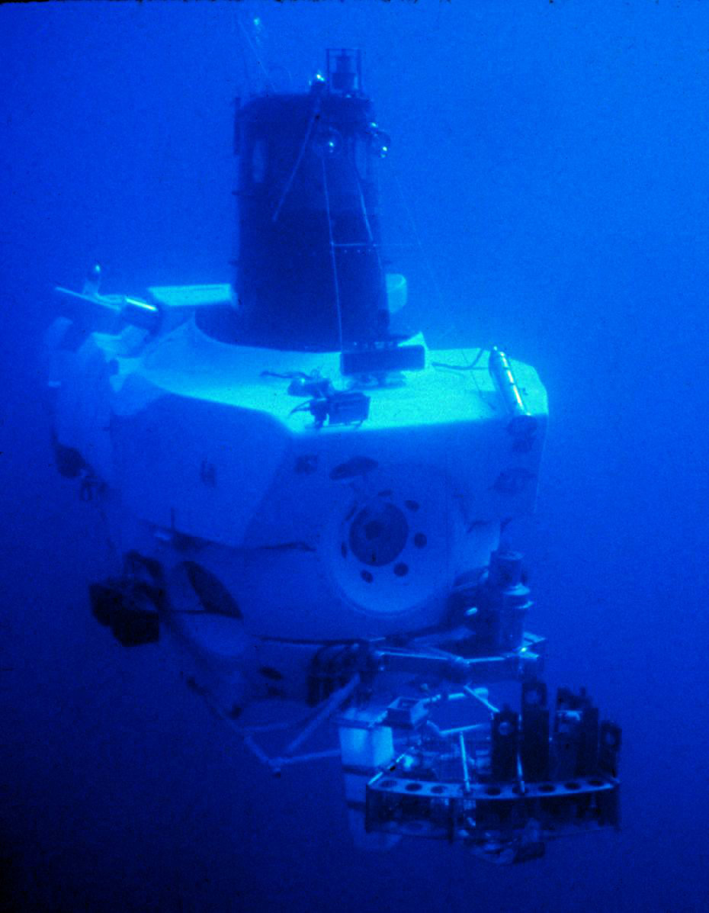

In 1977 the submersible *Alvin* found dense animal communities around hydrothermal vents on the Galápagos Rift. This was the first evidence of ecosystems that do **not depend on sunlight**. Microbes there harvest chemical energy (**chemosynthesis**) from compounds like hydrogen sulfide, methane and hydrogen.

## Three kinds of chemosynthetic habitat

| Habitat | Energy source | Lifespan | Iconic fauna |
|---|---|---|---|
| **Hydrothermal vents** | Hot fluids rich in H₂S, H₂, metals | Years to decades (volcanically reset) | Giant tubeworms, Pompeii worms, yeti crabs, scaly-foot snail |
| **Cold seeps** | Methane and sulfide seeping from sediments | Centuries to millennia | Seep mussels, clams, tubeworms, ice worms on methane hydrate |
| **Food falls** (whale, wood) | Decomposing organic matter producing sulfide | Years to decades | Osedax bone worms, hagfish, wood-boring bivalves |

## Symbiosis is the key

Most large chemosynthetic animals host bacteria **inside their bodies**. The giant tubeworm *Riftia* has no mouth or gut as an adult; a specialised organ holds billions of sulfur-oxidising bacteria fed by a special sulfide-carrying haemoglobin. See [Giant tube worm](/wiki/species/giant-tube-worm.html).

## A whale fall's life cycle

1. **Mobile scavenger stage** (months to years): sharks, hagfish and amphipods strip the flesh.
2. **Enrichment-opportunist stage** (years): worms and crustaceans colonise the enriched sediment. *Osedax* bores into the bones.
3. **Sulfophilic stage** (decades): bacteria decompose bone lipids, producing sulfide that supports chemosynthetic communities.

## Records and discoveries

- **Deepest chemosynthetic animal community:** 9,533 m (Kuril–Kamchatka Trench, *Nature* 2025)[^peng]. See [Hadal life](/wiki/life/hadal-life.html).
- **Lost City** (Mid-Atlantic Ridge): carbonate chimneys up to 60 m, powered by serpentinisation rather than magma. It is a leading model for the origin of life.

## Why it matters beyond Earth

Chemosynthesis shows that life can run on rock–water chemistry in total darkness. That is exactly the kind of energy that might exist in the subsurface oceans of **Europa** and **Enceladus**.

## Threats

Seafloor massive sulfide deposits that form at vents are potential mining targets. The vent-endemic **scaly-foot snail** was listed as Endangered by the IUCN because its few known vent fields lie within exploration licences. See [Deep-sea mining](/wiki/impacts/deep-sea-mining.html).

[^peng]: Peng, Du et al. 2025, *Nature*, press highlight — <https://www.natureasia.com/ja-jp/nature/pr-highlights/15298>
