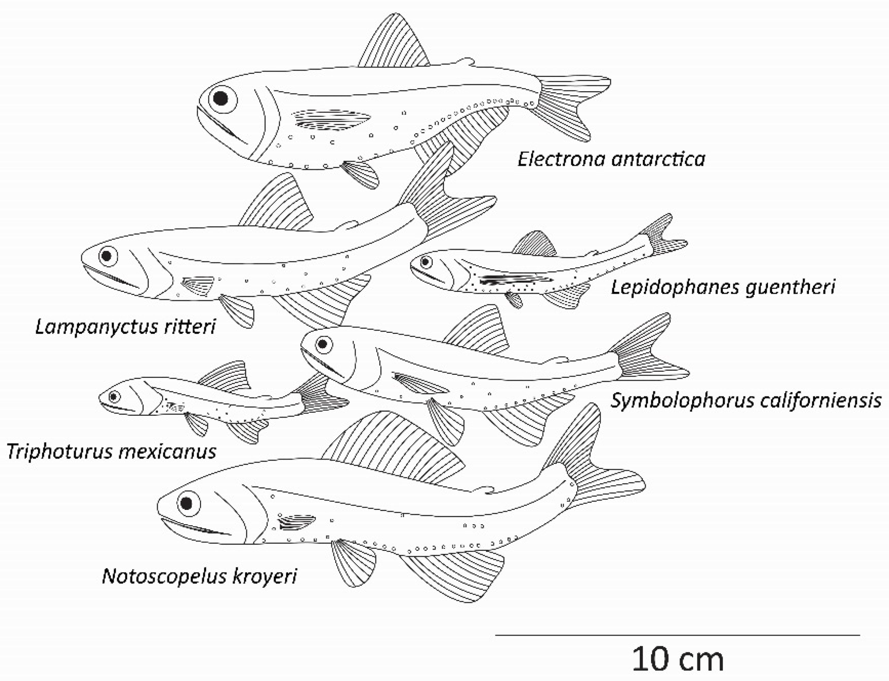

Fishes live from the surface to about **8,300 m**. The deepest is a snailfish filmed at 8,336 m in the Izu-Ogasawara Trench in 2022[^nhm]. Below that, pressure physiology appears to exclude them.

## By zone

| Zone | Typical fishes | Lifestyle |
|---|---|---|
| Twilight (200–1,000 m) | Lanternfish, hatchetfish, bristlemouths, barreleye | Vertical migrators; counter-illumination; large eyes |
| Midnight (1,000–4,000 m) | Anglerfish, gulper eels, viperfish, dragonfish | Sit-and-wait; lures; huge mouths; weak muscles |
| Abyssal seafloor | Grenadiers (rattails), cusk eels, tripod fish | Scavenging and hunting near the bottom |
| Hadal (6,000–8,300 m) | Snailfishes (Liparidae) | Trench specialists; top predators on amphipods |

**Bristlemouths** (*Cyclothone*) may be the most numerous vertebrates on Earth, possibly hundreds of trillions, yet few people have heard of them.

## Deep vs shallow fish

| Trait | Deep-sea fish | Shallow-water fish |
|---|---|---|
| Metabolism | Low | High |
| Muscles and skeleton | Reduced, watery | Strong, dense |
| Colour | Black, red or transparent | Bright signalling colours |
| Senses | Lateral line, smell, large or tubular eyes | Colour vision dominant |
| Reproduction | Rare encounters: dwarf males, hermaphroditism | Spawning aggregations, courtship displays |

See the repository's [deep vs shallow fish comparative notes](/biology/png/fish_type_matrix_generated.png) figure:

## The 8,200 m limit

Fishes accumulate **TMAO** to protect proteins from pressure. Concentrations rise linearly with depth and would make fish tissues hyperosmotic to seawater at around 8,200 m. Observations fit: fish are common to ~7,000–8,000 m and absent below about 8,400 m[^nhm]. See [Hadal life](/wiki/life/hadal-life.html).

## Explore the fishes

Browse profiles in the [Species Atlas](/wiki/species/index.html), including the anglerfish, viperfish, barreleye, tripod fish, coelacanth, orange roughy and Mariana snailfish.

[^nhm]: Natural History Museum, deepest-ever fish filmed at 8,336 m — <https://nhm.ac.uk/discover/news/2023/april/deepest-ever-fish-filmed-depth-8336-metres.html>
