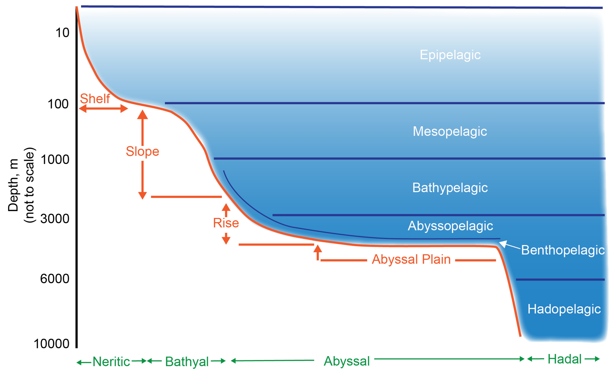

The **hadal zone**, the ocean trenches from 6,000 to ~11,000 m, makes up a tiny fraction of the seafloor but spans almost half the ocean's depth range. Each trench is an isolated, extreme habitat. Many host endemic species.

:::facts Key records
- **Deepest fish filmed:** a *Pseudoliparis* snailfish at **8,336 m**, Izu-Ogasawara Trench (2022)[^nhm].
- **Deepest fish caught:** *P. belyaevi* at **8,022 m**, Japan Trench[^nhm].
- **Deepest chemosynthetic animal community:** tubeworms and bivalves at **9,533 m**, Kuril–Kamchatka Trench (*Nature*, 2025)[^peng].
- **Deepest plastic bag:** **10,898 m**, Mariana Trench[^gwr].
:::

## Who lives there

- **Snailfishes**: the top fish predators, translucent and scaleless.
- **Amphipods**: scavenging crustaceans. *Hirondellea gigas* in the Challenger Deep can digest wood using enzymes. Giant amphipods (*Alicella gigantea*) reach ~30 cm.
- **Holothurians (sea cucumbers)**: often dominate trench floors by biomass.
- **Xenophyophores**: giant single-celled organisms.
- **Chemosynthetic communities**: siboglinid tubeworms and bivalves fed by methane and sulfide seeping along faults in the bending plate[^peng].

## The 2025 discovery

The crewed submersible *Fendouzhe* surveyed the Kuril–Kamchatka and western Aleutian trenches in July–August 2024. It found chemosynthesis-based communities over **~2,500 km** at **5,800–9,533 m**, with high sediment methane likely made by microbes in place[^peng]. That changes the picture of trench ecosystems from food-starved basins to places that can host methane-powered oases. Full analysis: [Peng et al. 2025](/wiki/library/peng-2025.html).

## Why trenches funnel food (and pollution)

The V-shape of trenches concentrates organic matter sliding down the slopes, and earthquakes trigger sediment avalanches. That supports surprising biomass, but it also concentrates **pollutants**. PCBs and microplastics have been found in hadal amphipods.

## Exploration

Only a handful of crewed dives have reached the deepest points: *Trieste* (1960), *Deepsea Challenger* (2012), *Limiting Factor* (2019 onwards) and *Fendouzhe* (2020 onwards). See [History of exploration](/wiki/exploration/history-of-exploration.html).

[^nhm]: Natural History Museum, deepest-ever fish — <https://nhm.ac.uk/discover/news/2023/april/deepest-ever-fish-filmed-depth-8336-metres.html>
[^peng]: Nature Asia press highlight, Peng, Du et al. 2025, doi:10.1038/s41586-025-09317-z — <https://www.natureasia.com/ja-jp/nature/pr-highlights/15298>
[^gwr]: Guinness World Records, deepest plastic debris (10,898 m) — <https://www.guinnessworldrecords.com/world-records/562338-deepest-plastic-debris-found-in-the-sea>
