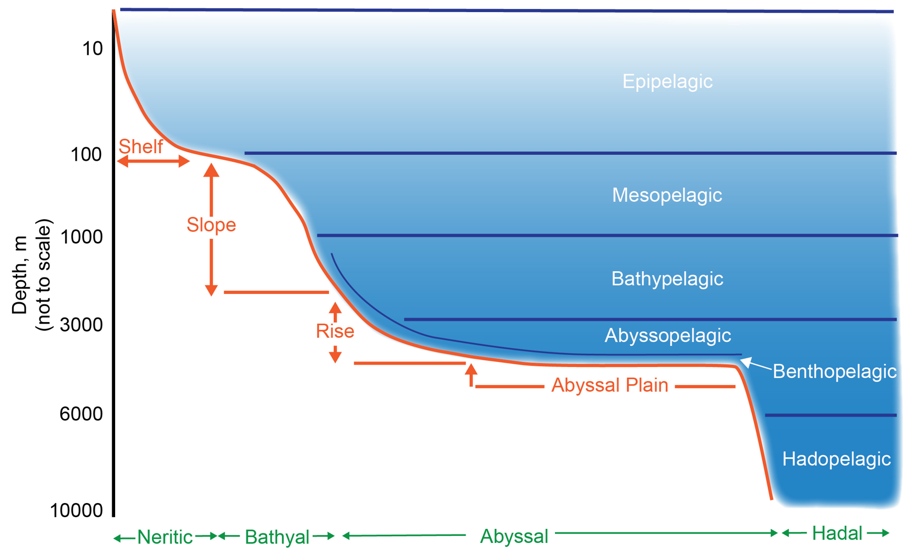

The deep sea is Earth's largest habitat by volume, yet every animal living there faces the same five problems. Looking at the solutions together explains why deep-sea creatures look the way they do.

## 1. Crushing pressure

Pressure reaches more than 1,000 atmospheres in trenches. Animals cope with **piezolytes** such as TMAO that stabilise proteins, with **flexible membranes** rich in unsaturated fats, and by avoiding gas spaces altogether (snailfish have no swim bladder)[^nhm]. See [Pressure, light and temperature](/wiki/ocean-system/pressure-light-temperature.html).

## 2. Darkness

No sunlight reaches below ~1,000 m. Responses include:

- **Huge or tubular eyes** in the twilight zone (barreleye, giant squid with the largest eyes of any animal).
- **Bioluminescence**: an estimated majority of mid-water animals make light. They use it for lures, counter-illumination camouflage, signalling and "burglar alarms" (see [Bioluminescence](/wiki/life/bioluminescence.html)).
- **Black or red colouring**, which is invisible in the absence of red light. Some dragonfishes have ultra-black skin absorbing over 99.5% of light.

## 3. Cold

Below the thermocline the water sits at ~0–4 °C. Metabolism slows, so many species grow slowly, mature late and live long. Orange roughy live over 150 years and Greenland sharks perhaps several centuries.

## 4. Scarce food

Almost all food sinks from above as marine snow, and only a small fraction reaches the abyss. Strategies:

| Strategy | Example |
|---|---|
| Sit-and-wait ambush with lures | Anglerfish, tripod fish |
| Huge mouths and expandable stomachs | Gulper eel, viperfish, black swallower |
| Opportunistic scavenging of food falls | Giant isopods, hagfish, amphipods |
| Long fasting | Giant isopods can survive years without food |
| Chemosynthesis instead of food from above | Tubeworms, vent mussels, scaly-foot snail |
| Vertical migration to feed at the surface | Lanternfish, krill |

## 5. Finding a mate

In a vast dark ocean with low population densities, encounters are rare. Evolutionary answers include **dwarf males** that track females by smell (anglerfish, Osedax), **hermaphroditism** so any encounter can produce offspring (tripod fish), and **sperm storage**.

## Gigantism and dwarfism

Some deep-sea groups grow far larger than their shallow relatives (**deep-sea gigantism**): giant isopods, giant amphipods, the colossal squid. Proposed explanations include cold temperatures (larger cell size), higher oxygen solubility in cold water, and efficiency for travelling between scarce food. Others are tiny: meiofauna dominate deep sediments by number.

## Browse the animals

See the [Species Atlas](/wiki/species/index.html) for individual profiles covering feeding, hunting, mating, migration and behaviour.

[^nhm]: Natural History Museum, deepest-ever fish and pressure adaptations — <https://nhm.ac.uk/discover/news/2023/april/deepest-ever-fish-filmed-depth-8336-metres.html>
