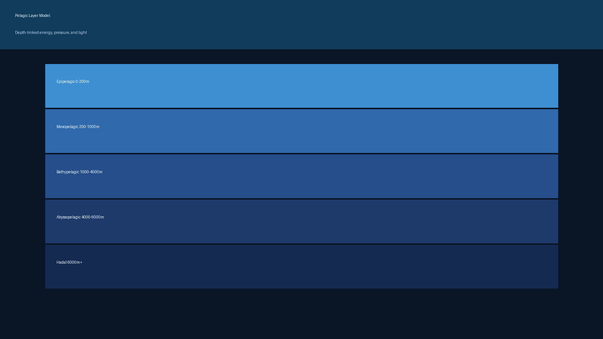

The ocean covers about 71% of Earth, but most of it is **deep ocean**, conventionally anything below 200 m. The deep ocean covers about 66% of the planet's entire surface[^bell]. Oceanographers divide the water column into zones by how much sunlight reaches them. Light, more than anything else, controls where food is made and how animals live.

:::facts Key facts
- **Deep ocean** begins where sunlight dwindles, at about 200 m[^noaadeep].
- Pressure rises by about **1 atmosphere every 10 m** of seawater[^noaapress], reaching about 1,100 atm in the deepest trench.
- Most of the ocean is **2,000–6,000 m deep**, and most of that is cold (≈0–4 °C) and dark.
:::

## The five pelagic zones

| Zone | Depth | Light | What defines it |
|---|---|---|---|
| **Epipelagic** (sunlight) | 0–200 m | Enough for photosynthesis | Phytoplankton make the food that feeds almost everything below |
| **Mesopelagic** (twilight) | 200–1,000 m | Dim blue, fading to none | The largest daily animal migration on Earth: lanternfish and krill rise at night to feed |
| **Bathypelagic** (midnight) | 1,000–4,000 m | None from the Sun | Light comes only from bioluminescence; food arrives as "marine snow" |
| **Abyssopelagic** (abyss) | 4,000–6,000 m | None | Near-freezing, very low food, vast flat abyssal plains |
| **Hadopelagic** (hadal) | 6,000–~11,000 m | None | Ocean trenches at subduction zones; extreme pressure and endemic species |

## Why the boundaries matter

**200 m: the end of photosynthesis.** Below this depth there isn't enough light for net primary production. Every animal deeper down depends on food that sinks or migrates from above, or (at vents and seeps) on chemical energy from the Earth. That is why deep ecosystems are often food-limited, and why the twilight zone acts as a gatekeeper. It decides how much surface carbon gets exported to depth (see [The biological carbon pump](/wiki/ocean-system/biological-carbon-pump.html)).

**1,000 m: total darkness.** Below about a kilometre no sunlight is detectable, even to animals with extremely sensitive eyes. Vision shifts from seeing sunlight to seeing living light, and many species evolve red pigments that look black in blue-dominated light.

**6,000 m: the hadal frontier.** Trenches are isolated "islands" of extreme depth. Their faunas are distinctive, and they hold life's depth records: fish to ~8,300 m, and chemosynthetic animal communities down to 9,533 m (see [Hadal life](/wiki/life/hadal-life.html)).

## Benthic zones: the seafloor equivalents

The seafloor has parallel names: **bathyal** (continental slope, ~200–4,000 m), **abyssal** (4,000–6,000 m) and **hadal** (6,000 m+). Most deep-sea biodiversity lives here, on or in the sediment, rather than in the open water.

## How we know so little

Even these "textbook" boundaries rest on remarkably few direct observations. A 2025 study estimated that only about **0.001%** of the deep seafloor has ever been imaged[^bell]. See [How little we have seen](/wiki/exploration/how-little-we-have-seen.html).

[^noaadeep]: NOAA Ocean Exploration, "How deep is the deep ocean?" — <https://oceanexplorer.noaa.gov/facts/deep-ocean.html>
[^noaapress]: NOAA Ocean Service, "Does the ocean get more salty or less salty with depth? / Pressure fact" — <https://oceanservice.noaa.gov/facts/pressure.html>
[^bell]: Bell K.L.C. et al. (2025), "How little we've seen: A visual coverage estimate of the deep seafloor", *Science Advances* 11(19) — <https://www.science.org/doi/10.1126/sciadv.adp8602>
