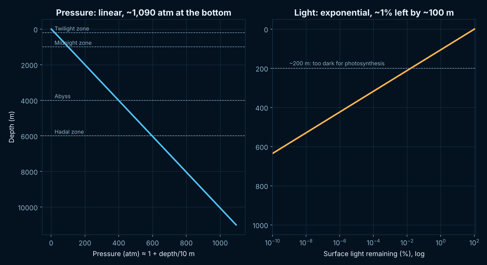

Three physical gradients define the deep sea. **Pressure** climbs in a straight line, **light** collapses exponentially, and **temperature** drops sharply then flattens. Each one sets hard limits on biology and engineering.

## Pressure: linear and relentless

Seawater adds roughly **one atmosphere of pressure for every ~10 m** of depth[^noaapress]:

> P ≈ 1 atm + depth (m) / 10.06

At the abyssal plain (~4,500 m) that is ~450 atm. At the Challenger Deep (~10,935 m) it is about **1,090 atm, roughly 110 MPa**, the weight of about a tonne pressing on every square centimetre.

**What pressure does to life.** High pressure squeezes molecules. It changes how proteins fold, makes cell membranes stiff and slows enzymes. Deep-sea animals adapt in three main ways:

1. **Piezolytes**, small molecules that stabilise proteins. The best known is **TMAO** (trimethylamine N-oxide), whose concentration in fish muscle rises with depth[^nhm].
2. **Flexible membranes** with more unsaturated fats, which stay fluid under pressure.
3. **No gas spaces.** Deep fishes such as snailfish lack swim bladders, because gas would be compressed to almost nothing.

**Why fish stop at ~8,200–8,400 m.** TMAO concentrations rise so much with depth that, extrapolated, fish tissue would become saltier (more concentrated) than seawater at roughly 8,200 m. That would cause osmotic problems. The deepest fish ever filmed, a snailfish at **8,336 m**, sits right at this predicted limit[^nhm]. Invertebrates face no identical ceiling, which is why tubeworms and amphipods live deeper.

## Light: exponential collapse

Sunlight is absorbed and scattered as it passes through water. Red goes first (within ~10 m), then yellow and green, and blue penetrates furthest. In very clear ocean water, roughly **1%** of surface light remains near 100 m. Effectively no photosynthesis is possible below about **200 m**[^noaadeep], and no sunlight is detectable below about 1,000 m.

Consequences:

- **Colour:** red animals look black in the deep because there is no red light to reflect.
- **Eyes:** twilight-zone animals have huge or tubular eyes tuned to blue. Some deep fishes add red-light "searchlights" that most prey cannot see.
- **Bioluminescence** becomes the main light source. See [Bioluminescence](/wiki/life/bioluminescence.html).

## Temperature: a thermocline, then cold stability

Surface water ranges from below 0 °C at the poles to ~30 °C in the tropics. Below the **thermocline** (typically within the upper ~1,000 m), temperatures drop to a remarkably uniform **~0–4 °C** throughout most of the deep ocean[^noaapress2]. Exceptions are hydrothermal vents, where fluids can exceed 350 °C, and the warm (~13 °C) deep Mediterranean.

Cold slows metabolism. Combined with scarce food, it explains the **slow life histories** of many deep animals: slow growth, late maturity and long lifespans. Some deep-sea corals live for thousands of years. Slow life histories are also why deep ecosystems recover so slowly from damage (see [Deep-sea mining](/wiki/impacts/deep-sea-mining.html)).

## Engineering at depth

Every vehicle that goes deep must handle the same pressure. Full-ocean-depth crew spheres use thick titanium hulls. Buoyancy comes from syntactic foam (glass microspheres in resin), because air-filled floats would be crushed. Electronics are either pressure-housed or oil-filled and pressure-compensated. See [Vehicles and technology](/wiki/exploration/vehicles-and-technology.html).

## Try it yourself

The [Dive Profile Lab](/labs/dive-profile-lab.html) lets you drag a probe from 0 to 10,935 m and watch pressure, light, temperature, a balloon's volume (Boyle's law) and the resident life change.

[^noaapress]: NOAA Ocean Service, pressure increases ~1 atm per 10 m — <https://oceanservice.noaa.gov/facts/pressure.html>
[^noaapress2]: NOAA Ocean Exploration, how pressure affects deep-sea animals — <https://oceanexplorer.noaa.gov/ocean-fact/animal-pressure/>
[^noaadeep]: NOAA Ocean Exploration, deep ocean definition — <https://oceanexplorer.noaa.gov/facts/deep-ocean.html>
[^nhm]: Natural History Museum, "Deepest-ever fish filmed at a depth of 8,336 metres" (TMAO and fish depth limit) — <https://nhm.ac.uk/discover/news/2023/april/deepest-ever-fish-filmed-depth-8336-metres.html>
