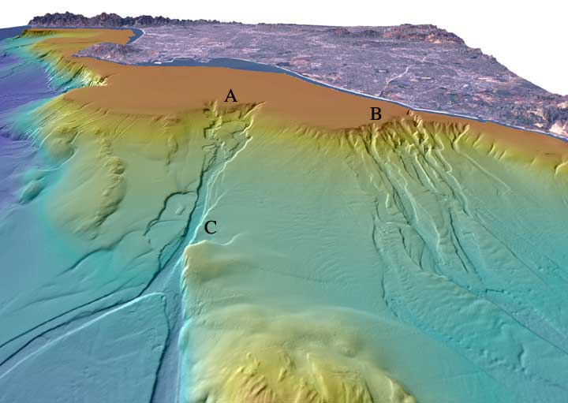
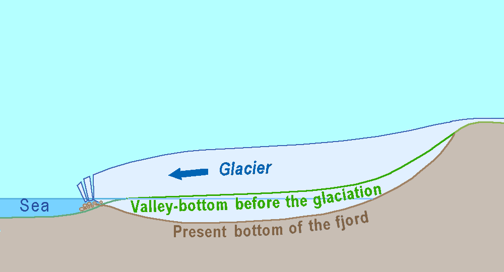
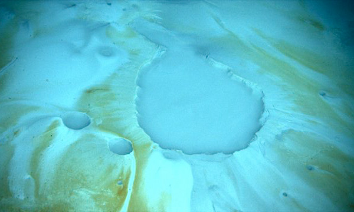

## Submarine canyons

Canyons cut into continental shelves and slopes, some rivalling the Grand Canyon. They act as **highways** carrying sediment, organic matter (and litter) from the coast to the abyss, often via turbidity currents. They are biodiversity hotspots, and some, such as **Monterey Canyon**, are among the best-studied deep habitats on Earth. Monterey alone accounts for ~48% of all canyon observations, and only 442 of 9,472 known canyons have ever been seen[^gz].

## Fjords

Glaciers carved deep, steep inlets now flooded by the sea. Shallow sills at the mouth trap deep water, which can become low in oxygen. Norwegian fjords host **cold-water coral** reefs at unusually shallow depths, so deep-sea species can be studied near the surface.

## Brine pools

Where ancient salt deposits dissolve beneath the seafloor (Gulf of Mexico, Red Sea, Mediterranean), extremely dense brine collects in depressions. These "lakes" have their own shorelines and waves.

- Salinity can be several times that of seawater, and the brine is often anoxic and methane-rich.
- Animals that swim in can be killed and pickled. The Gulf of Mexico's "Jacuzzi of Despair" is ringed by mussels feeding on methane at its edge.
- Microbes inside are studied as analogues for possible life on Mars and icy moons.

[^gz]: Gigazine summary of Bell et al. 2025 (canyon observation statistics) — <https://wbgsv0a.gigazine.net/gsc_news/en/20250518-deep-seafloor-study-reveals>
