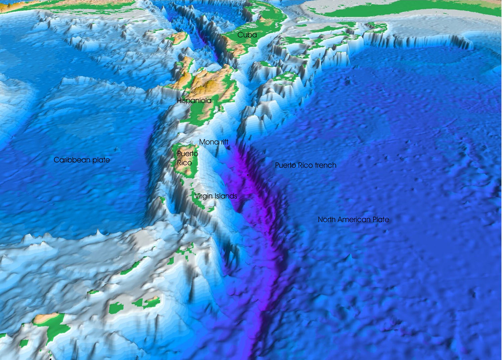

Ocean trenches are long, narrow depressions where an oceanic plate **subducts** beneath another plate. They hold all of Earth's deepest points and most of the **hadal zone** (>6,000 m).

## Deepest trenches

| Trench | Ocean | Max depth (approx.) |
|---|---|---|
| Mariana (Challenger Deep) | Pacific | ~10,935 m |
| Tonga (Horizon Deep) | Pacific | ~10,800 m |
| Kuril–Kamchatka | Pacific | ~9,600 m |
| Philippine (Galathea Depth) | Pacific | ~10,500 m |
| Kermadec | Pacific | ~10,000 m |
| Izu-Ogasawara | Pacific | ~9,800 m |
| Puerto Rico (Milwaukee Deep) | Atlantic | ~8,400 m |
| South Sandwich (Factorian Deep) | Southern | ~7,400 m |
| Java (Sunda) | Indian | ~7,290 m |

## How trenches work

As the down-going plate bends, it cracks into normal faults. These faults channel fluids, and in the Kuril–Kamchatka Trench they feed methane seeps that support chemosynthetic life down to 9,533 m[^peng]. Subduction also drives the **largest earthquakes** (megathrust events such as Tōhoku 2011 and Sumatra 2004), tsunamis, and the volcanic arcs of the Pacific Ring of Fire.

## Trenches as sinks

The trench shape funnels sediment, organic carbon and pollution downslope. Trenches store organic carbon at higher rates than the surrounding abyss, and they accumulate plastics and persistent pollutants.

## Life

See [Hadal life](/wiki/life/hadal-life.html): snailfish, giant amphipods, sea cucumbers, xenophyophores and chemosynthetic oases.

[^peng]: Peng, Du et al. 2025, *Nature*, press highlight — <https://www.natureasia.com/ja-jp/nature/pr-highlights/15298>
