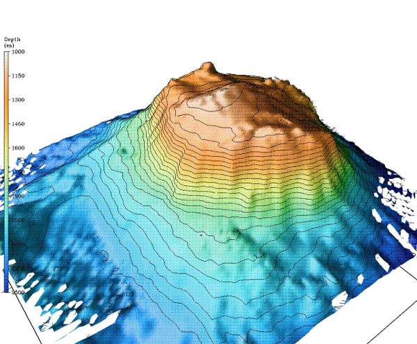

## Seamounts

**Seamounts** are underwater mountains, mostly extinct volcanoes, that rise at least 1,000 m above the seafloor without breaking the surface. Estimates suggest there are tens of thousands of large seamounts, most of them never visited.

**Why they are oases:** seamounts deflect currents, causing local upwelling and trapping plankton. That supports cold-water corals, sponges, and aggregations of fish such as **orange roughy**, alongside sharks, tuna and seabirds above.

**Vulnerability:** seamount fisheries in the 1980s–90s stripped coral habitats that will take centuries or millennia to regrow. Cobalt-rich crusts on seamount flanks are also potential mining targets.

## Abyssal plains

At 3,000–6,000 m, **abyssal plains** are among the flattest surfaces on Earth, built by sediments that blanket the underlying crust. They cover a large fraction of the ocean floor.

- **Food:** very little. The fauna depends on marine snow and seasonal pulses of phytodetritus.
- **Fauna:** sea cucumbers (sea pigs), brittle stars, xenophyophores, nematodes and polychaete worms. Diversity is surprisingly high but densities are low.
- **Nodule fields:** polymetallic nodules cover large parts of some plains, especially the Clarion-Clipperton Zone (see [Polymetallic nodules](/wiki/seafloor/polymetallic-nodules.html)).
- **Exploration gap:** abyssal plains and seamounts are among the least visually explored habitats[^bell].

[^bell]: Ocean Discovery League / EurekAlert release on Bell et al. 2025 — <https://www.eurekalert.org/news-releases/1082535>
